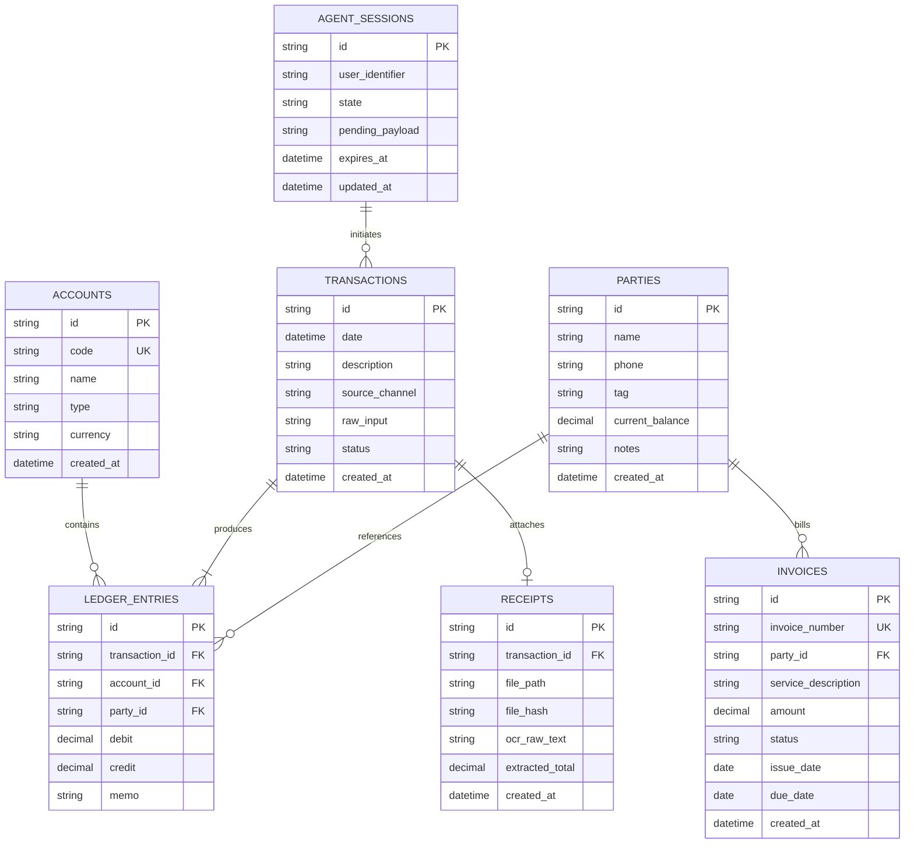

# Database Schema & Data Models Specification
## Project Name: W2L (WhatsApp to Ledger)
### Database Engine: SQLite 3 with Write-Ahead Logging (WAL) Mode

---

## 1. Entity-Relationship Diagram (ERD)



---

## 2. Table Schemas & Data Dictionaries

### 2.1 Table: `accounts` (Chart of Accounts)
Tracks standard financial accounts based on double-entry principles.

| Column | Type | Constraints | Description |
| :--- | :--- | :--- | :--- |
| `id` | `TEXT` | PRIMARY KEY | UUIDv4 string. |
| `code` | `TEXT` | UNIQUE, NOT NULL | Account code (e.g. `1010` for Cash, `4010` for Sales). |
| `name` | `TEXT` | NOT NULL | Display name (e.g. `Cash on Hand`, `Bank Account`, `Rent Expense`). |
| `type` | `TEXT` | NOT NULL | Enum: `ASSET`, `LIABILITY`, `EQUITY`, `REVENUE`, `EXPENSE`. |
| `currency` | `TEXT` | DEFAULT 'PKR' | 3-letter currency code (e.g. `PKR`, `USD`, `INR`). |
| `created_at` | `DATETIME` | DEFAULT CURRENT_TIMESTAMP | Row timestamp. |

### 2.2 Table: `parties` (Customers, Suppliers, Khata Contacts)
Maintains individuals or businesses who have credit, debit, or business dealings.

| Column | Type | Constraints | Description |
| :--- | :--- | :--- | :--- |
| `id` | `TEXT` | PRIMARY KEY | UUIDv4 string. |
| `name` | `TEXT` | NOT NULL | Full name of the party (e.g. `Bilal`). |
| `phone` | `TEXT` | NULLABLE | Contact telephone / WhatsApp number. |
| `tag` | `TEXT` | NULLABLE | Disambiguation tag (e.g. `Electrician`, `Shop 4`, `Cloth`). |
| `current_balance` | `REAL` | DEFAULT 0.0 | Net balance (+ is Receivable/Udhar lena hai, - is Payable/Dena hai). |
| `notes` | `TEXT` | NULLABLE | Additional context. |
| `created_at` | `DATETIME` | DEFAULT CURRENT_TIMESTAMP | Row timestamp. |

### 2.3 Table: `transactions`
Header table for business financial occurrences.

| Column | Type | Constraints | Description |
| :--- | :--- | :--- | :--- |
| `id` | `TEXT` | PRIMARY KEY | UUIDv4 string. |
| `date` | `DATETIME` | NOT NULL | Timestamp of when the transaction occurred. |
| `description` | `TEXT` | NOT NULL | Human-readable description (e.g. `Paid electricity bill`). |
| `source_channel` | `TEXT` | NOT NULL | Enum: `WHATSAPP_VOICE`, `WHATSAPP_IMAGE`, `WHATSAPP_TEXT`, `WEB_MANUAL`. |
| `raw_input` | `TEXT` | NULLABLE | Original audio transcript or message text. |
| `status` | `TEXT` | DEFAULT 'POSTED' | Enum: `POSTED`, `VOID`, `DRAFT`. |
| `created_at` | `DATETIME` | DEFAULT CURRENT_TIMESTAMP | Row creation timestamp. |

### 2.4 Table: `ledger_entries`
Double-entry balanced accounting line items. Sum of `debit` must equal sum of `credit` per `transaction_id`.

| Column | Type | Constraints | Description |
| :--- | :--- | :--- | :--- |
| `id` | `TEXT` | PRIMARY KEY | UUIDv4 string. |
| `transaction_id` | `TEXT` | NOT NULL, FK(`transactions.id`) | Cascading foreign key to transaction. |
| `account_id` | `TEXT` | NOT NULL, FK(`accounts.id`) | Account debited or credited. |
| `party_id` | `TEXT` | NULLABLE, FK(`parties.id`) | Optional party associated with this entry. |
| `debit` | `REAL` | DEFAULT 0.0 | Debit value. |
| `credit` | `REAL` | DEFAULT 0.0 | Credit value. |
| `memo` | `TEXT` | NULLABLE | Specific line-item comment. |

### 2.5 Table: `invoices`
Tracks client and supplier invoices matching the dashboard UI requirements.

| Column | Type | Constraints | Description |
| :--- | :--- | :--- | :--- |
| `id` | `TEXT` | PRIMARY KEY | UUIDv4 string. |
| `invoice_number` | `TEXT` | UNIQUE, NOT NULL | E.g., `INV-10021`. |
| `party_id` | `TEXT` | NOT NULL, FK(`parties.id`) | Client or supplier entity. |
| `service_description` | `TEXT` | NOT NULL | Brief summary (e.g., `Branding Design`, `Mobile App UI`). |
| `amount` | `REAL` | NOT NULL | Total monetary value. |
| `status` | `TEXT` | NOT NULL | Enum: `PAID`, `PENDING`, `OVERDUE`. |
| `issue_date` | `DATE` | NOT NULL | Date invoice was generated. |
| `due_date` | `DATE` | NOT NULL | Date payment is expected. |
| `created_at` | `DATETIME` | DEFAULT CURRENT_TIMESTAMP | Creation timestamp. |

### 2.6 Table: `receipts`
Metadata for visual bills, paper receipts, and OCR extraction.

| Column | Type | Constraints | Description |
| :--- | :--- | :--- | :--- |
| `id` | `TEXT` | PRIMARY KEY | UUIDv4 string. |
| `transaction_id` | `TEXT` | NULLABLE, FK(`transactions.id`) | Linked transaction. |
| `file_path` | `TEXT` | NOT NULL | Relative disk path (e.g., `uploads/receipts/2026/03/uuid.jpg`). |
| `file_hash` | `TEXT` | NOT NULL | SHA-256 hash to prevent duplicate scanning. |
| `ocr_raw_text` | `TEXT` | NULLABLE | Extracted text from Gemini Vision. |
| `extracted_total` | `REAL` | NULLABLE | Machine-recognized total. |
| `created_at` | `DATETIME` | DEFAULT CURRENT_TIMESTAMP | Upload timestamp. |

### 2.7 Table: `agent_sessions`
Manages stateful WhatsApp interactions, particularly disambiguation flows.

| Column | Type | Constraints | Description |
| :--- | :--- | :--- | :--- |
| `id` | `TEXT` | PRIMARY KEY | Session identifier / phone number hash. |
| `user_identifier` | `TEXT` | NOT NULL | WhatsApp thread ID or user identifier. |
| `state` | `TEXT` | NOT NULL | Enum: `IDLE`, `AWAITING_DISAMBIGUATION`, `AWAITING_CONFIRMATION`. |
| `pending_payload` | `TEXT` | NULLABLE | JSON string holding the uncommitted transaction details. |
| `expires_at` | `DATETIME` | NOT NULL | Expiry threshold (typically 15 minutes). |
| `updated_at` | `DATETIME` | DEFAULT CURRENT_TIMESTAMP | Last activity. |

---

## 3. SQL Data Definition Language (DDL) Script

```sql
PRAGMA journal_mode = WAL;
PRAGMA foreign_keys = ON;

-- Accounts
CREATE TABLE IF NOT EXISTS accounts (
    id TEXT PRIMARY KEY,
    code TEXT UNIQUE NOT NULL,
    name TEXT NOT NULL,
    type TEXT CHECK(type IN ('ASSET', 'LIABILITY', 'EQUITY', 'REVENUE', 'EXPENSE')) NOT NULL,
    currency TEXT DEFAULT 'PKR',
    created_at DATETIME DEFAULT CURRENT_TIMESTAMP
);

-- Parties
CREATE TABLE IF NOT EXISTS parties (
    id TEXT PRIMARY KEY,
    name TEXT NOT NULL,
    phone TEXT,
    tag TEXT,
    current_balance REAL DEFAULT 0.0,
    notes TEXT,
    created_at DATETIME DEFAULT CURRENT_TIMESTAMP
);
CREATE INDEX IF NOT EXISTS idx_parties_name ON parties(name);

-- Transactions
CREATE TABLE IF NOT EXISTS transactions (
    id TEXT PRIMARY KEY,
    date DATETIME NOT NULL,
    description TEXT NOT NULL,
    source_channel TEXT CHECK(source_channel IN ('WHATSAPP_VOICE', 'WHATSAPP_IMAGE', 'WHATSAPP_TEXT', 'WEB_MANUAL')) NOT NULL,
    raw_input TEXT,
    status TEXT DEFAULT 'POSTED' CHECK(status IN ('POSTED', 'VOID', 'DRAFT')),
    created_at DATETIME DEFAULT CURRENT_TIMESTAMP
);
CREATE INDEX IF NOT EXISTS idx_transactions_date ON transactions(date);

-- Ledger Entries
CREATE TABLE IF NOT EXISTS ledger_entries (
    id TEXT PRIMARY KEY,
    transaction_id TEXT NOT NULL REFERENCES transactions(id) ON DELETE CASCADE,
    account_id TEXT NOT NULL REFERENCES accounts(id),
    party_id TEXT REFERENCES parties(id),
    debit REAL DEFAULT 0.0 CHECK(debit >= 0),
    credit REAL DEFAULT 0.0 CHECK(credit >= 0),
    memo TEXT
);
CREATE INDEX IF NOT EXISTS idx_ledger_tx ON ledger_entries(transaction_id);
CREATE INDEX IF NOT EXISTS idx_ledger_account ON ledger_entries(account_id);
CREATE INDEX IF NOT EXISTS idx_ledger_party ON ledger_entries(party_id);

-- Invoices
CREATE TABLE IF NOT EXISTS invoices (
    id TEXT PRIMARY KEY,
    invoice_number TEXT UNIQUE NOT NULL,
    party_id TEXT NOT NULL REFERENCES parties(id),
    service_description TEXT NOT NULL,
    amount REAL NOT NULL CHECK(amount > 0),
    status TEXT CHECK(status IN ('PAID', 'PENDING', 'OVERDUE')) NOT NULL,
    issue_date DATE NOT NULL,
    due_date DATE NOT NULL,
    created_at DATETIME DEFAULT CURRENT_TIMESTAMP
);
CREATE INDEX IF NOT EXISTS idx_invoices_status ON invoices(status);

-- Receipts
CREATE TABLE IF NOT EXISTS receipts (
    id TEXT PRIMARY KEY,
    transaction_id TEXT REFERENCES transactions(id) ON DELETE SET NULL,
    file_path TEXT NOT NULL,
    file_hash TEXT NOT NULL,
    ocr_raw_text TEXT,
    extracted_total REAL,
    created_at DATETIME DEFAULT CURRENT_TIMESTAMP
);

-- Agent Sessions
CREATE TABLE IF NOT EXISTS agent_sessions (
    id TEXT PRIMARY KEY,
    user_identifier TEXT NOT NULL,
    state TEXT CHECK(state IN ('IDLE', 'AWAITING_DISAMBIGUATION', 'AWAITING_CONFIRMATION')) NOT NULL,
    pending_payload TEXT,
    expires_at DATETIME NOT NULL,
    updated_at DATETIME DEFAULT CURRENT_TIMESTAMP
);
CREATE INDEX IF NOT EXISTS idx_sessions_user ON agent_sessions(user_identifier);
```
