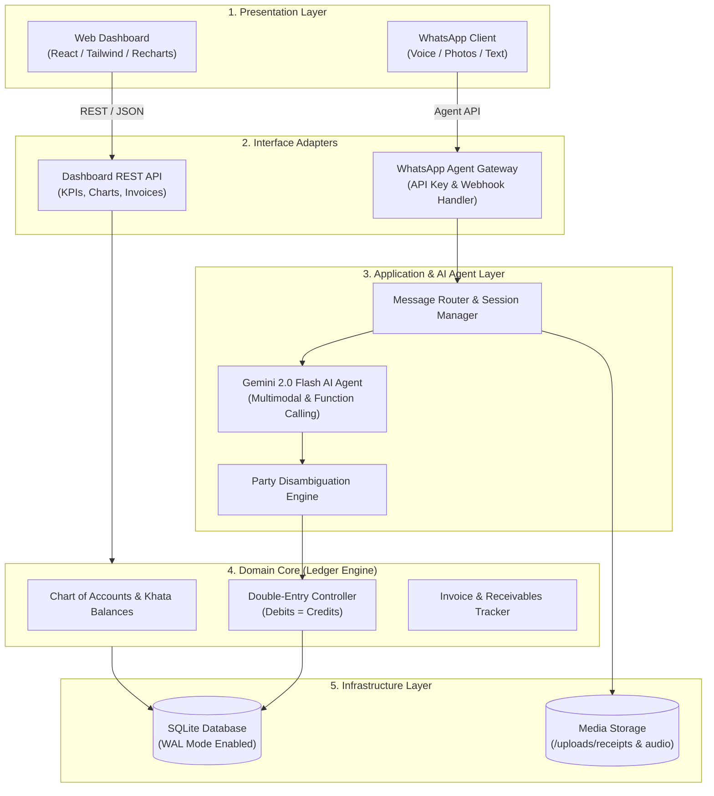
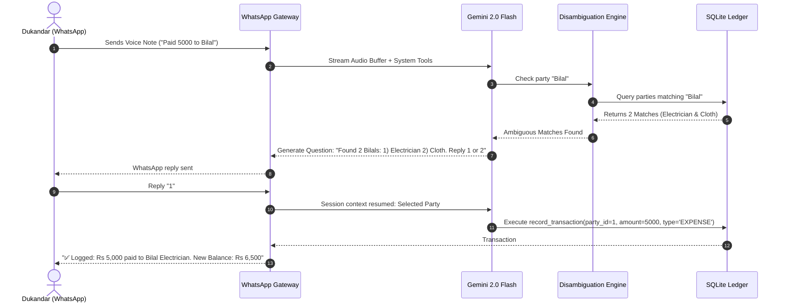

# Software Design Document (SDD)
## Project Name: W2L (WhatsApp to Ledger)
### Architecture: Clean Layered Architecture & Event-Driven Multimodal Agent

---

## 1. Architectural Overview

W2L is architected using **Clean Architecture** principles to decouple the user interfaces (WhatsApp Agent and Web Dashboard) from the core accounting logic and database persistence.

---

## 2. Key Component Specifications

### 2.1 WhatsApp Ingestion Gateway (`src/whatsapp/`)
* **Role:** Intercepts incoming messages from the WhatsApp Third-Party Agent interface.
* **Authentication:** Validates the incoming header `Authorization: Bearer <WHATSAPP_AGENT_API_KEY>`.
* **Payload Normalization:** Unifies Voice audio buffers (`.ogg`/`.opus`), Image buffers (`.jpg`/`.png`), and plain text strings into a standardized internal `AgentMessage` object.

### 2.2 Multimodal AI Agent (`src/ai/`)
* **Role:** Acts as the cognitive decision-maker using Gemini 2.0 Flash.
* **Tool Calling Execution:** Equipped with strict schema tools:
  * `record_transaction`: Commits income, expense, or transfer.
  * `query_ledger`: Reads historical records for user Q&A.
  * `disambiguate_party`: Inquires when multiple party matches exist.
  * `get_financial_summary`: Returns today's / this month's financial metrics.

### 2.3 Party Disambiguation Engine (`src/ledger/disambiguate.ts`)
* **Problem Solved:** Prevents erroneous accounting entries when multiple clients share identical or phonetic first names (e.g., "Bilal", "Ali", "Ahmed").
* **State Management:** When a conflict occurs, an entry is written into the `agent_sessions` table with state `AWAITING_DISAMBIGUATION` and a timeout of 15 minutes. Subsequent user messages on that thread are routed to the resolution handler before standard prompt evaluation.

### 2.4 Double-Entry Ledger Core (`src/ledger/engine.ts`)
Ensures transactional integrity by generating paired balanced journal entries:
* **Cash Sale:** Debit `Assets:Cash`, Credit `Revenue:Sales`.
* **Credit Sale (Udhar):** Debit `Assets:AccountsReceivable (Party)`, Credit `Revenue:Sales`.
* **Expense Paid:** Debit `Expenses:Category`, Credit `Assets:Cash/Bank`.
* **Supplier Credit:** Debit `Expenses:Inventory`, Credit `Liabilities:AccountsPayable (Party)`.

---

## 3. Technology Stack & Zero-Cost Justification

| Layer | Selected Tech | Zero-Cost ($0) Justification |
| :--- | :--- | :--- |
| **Backend Runtime** | Node.js (v20+) with TypeScript | Open source, fast execution, cross-platform. |
| **HTTP Framework** | Fastify / Express | Minimal footprint, sub-millisecond route handling. |
| **Database** | SQLite with `better-sqlite3` | Zero configuration, zero cloud hosting bills, local file storage, ACID compliance, capable of 100k+ writes/sec in WAL mode. |
| **AI Engine** | Google Gemini 2.0 Flash | Completely free tier via Google AI Studio API key (15 requests/min, 1,500 requests/day). |
| **Frontend Framework** | React / Next.js with Tailwind CSS | Modern, declarative, zero licensing costs. |
| **Charts & Visuals** | Recharts & Lucide Icons | Clean SVG charts matching the Lukana Business Finance design. |

---

## 4. Scalability & Resilience Design
1. **SQLite WAL Mode:** Write-Ahead Logging (`PRAGMA journal_mode = WAL;`) allows concurrent readers while a write is ongoing, eliminating lock contention between the WhatsApp ingestion and the Web Dashboard.
2. **Crash Recovery:** Session states and uploaded file paths are persisted immediately to disk; unexpected process restarts do not compromise unconfirmed transactions.
3. **Local Receipt Preservation:** All receipt images are saved in `data/receipts/{YYYY-MM}/{UUID}.jpg` with cryptographic SHA-256 hashes to prevent duplicate submissions.
